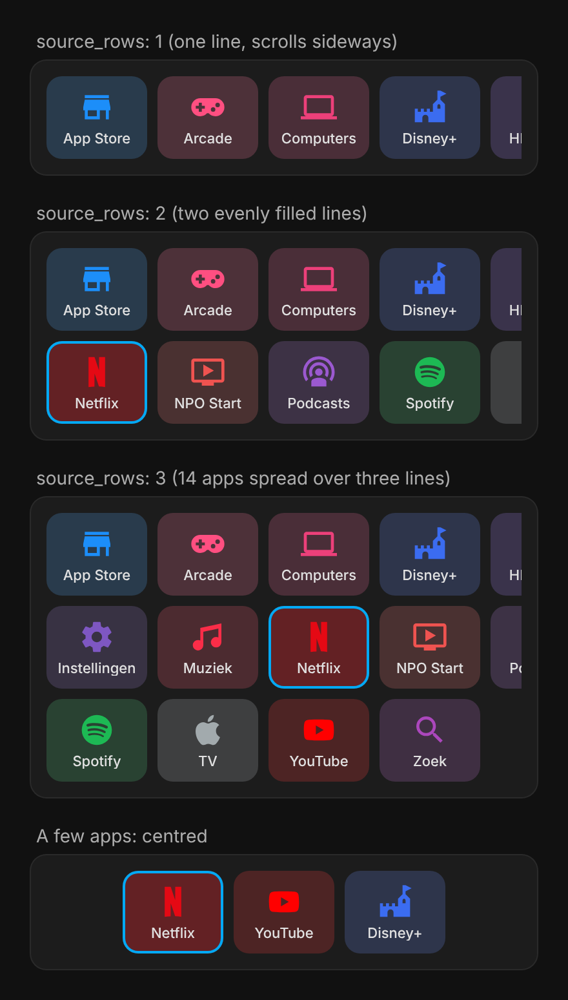
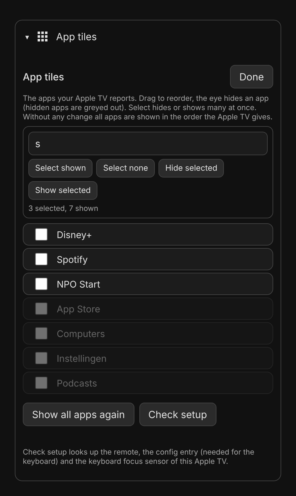

# Apple TV Remote for Home Assistant

[](https://hacs.xyz)
[](https://www.home-assistant.io)
[](LICENSE)

A phone remote for your **Apple TV**, as a Home Assistant dashboard card: a **touchpad**, **tiles for your apps**, a **keyboard**,
**control centre** and an **app switcher** button. Everything is set up in the card's visual editor, no YAML needed.


<sub>The pictures in this README are rendered images made with the card's own code and sample data, not screenshots from a phone. They use a dark theme; the card in your dashboard follows your own theme.</sub>

## Features

- **Touchpad**: swipe = arrow keys, tap = select, tap near an edge = that arrow. The step depends on your speed: swipe slowly and
  you move one item per 96 px, swipe fast and you move an item every 22 px. Commands are sent at most every 140 ms, because the
  Apple TV drops commands that arrive faster.
- **App tiles** for every app your Apple TV reports. Known apps get their icon and brand colour, everything else a neutral icon
  and its own stable colour. A tile wakes a sleeping Apple TV first.
- **Buttons**: power, back, TV / Home, play / pause, volume down / up and an app switcher. The Apple TV has no mute key, so there
  is none.
- **Power**: tap = control centre (the TV key held for 1 s), hold = sleep, and it wakes the Apple TV when it is asleep.
- **Keyboard**: the text box opens by itself when a text field on the Apple TV has focus, or with the keyboard button on the pad.
  What you type is mirrored into that field.
- Haptics on taps, one card per Apple TV for several Apple TVs, nothing to install on the Apple TV, no dashboard resource to add:
  the card loads itself.

## Requirements

- Home Assistant **2024.8** or newer.
- The core **Apple TV** integration, set up for your Apple TV (this integration builds on it and uses its remote, media player and
  keyboard services).
- The **volume** buttons only work when the Apple TV is set up to control your TV or soundbar volume (HDMI-CEC or IR).

## Installation

### HACS (custom repository)

[](https://my.home-assistant.io/redirect/hacs_repository/?owner=vandalon&repository=ha-apple-tv-remote&category=integration)

The button above opens HACS in your Home Assistant and offers to add this repository. Or add it by hand:

1. Open **HACS** in the sidebar, then the menu (three dots, top right) **> Custom repositories**.
2. Paste `https://github.com/vandalon/ha-apple-tv-remote`, choose the type **Integration** and press **Add**.
3. Close the dialog and open the **Marketplace** in HACS (older HACS versions call it *Explore & download repositories*).
   Search for **Apple TV Remote** and press **Download**.
4. **Restart Home Assistant** (Settings > System > Restart). HACS asks for this after the download as well.

Updates then show up in HACS like any other integration; restart Home Assistant after each update, the Python part is only loaded at
startup. HACS can only reach a repository that is public (or that you gave HACS access to).

### Manual (without HACS)

1. **Download** the package: on the repository page press **Code > Download ZIP** (or download the source of the latest release),
   and unzip it. You only need the folder `custom_components/apple_tv_remote`.
2. **Copy that folder** into the `custom_components` folder of your Home Assistant configuration, so that you end up with
   `config/custom_components/apple_tv_remote/manifest.json` (create `custom_components` if it does not exist). Ways to get there:
   - the **Samba share** add-on (the `config` share), the **File editor** or **Studio Code Server** add-on, or the **Advanced SSH** add-on;
   - on Home Assistant Container/Core simply copy it to your configuration directory, for example
     `cp -r custom_components/apple_tv_remote /path/to/config/custom_components/` on Linux or macOS.
3. **Restart Home Assistant** (Settings > System > Restart).
4. Continue with [Setup](#setup).

To update, replace the `apple_tv_remote` folder with the new version and restart Home Assistant again.

## Setup

1. **Settings > Devices & services > Add integration > Apple TV Remote** (one click, nothing to configure).
2. Open a dashboard, **Edit dashboard > Add card**, search for **Apple TV remote** and pick your Apple TV.

```yaml
type: custom:atv-touchpad
entity: media_player.living_room_apple_tv
```

Only the **entity** (the Apple TV media player) is needed. The card finds the remote entity, the config entry (for the keyboard) and
the keyboard focus sensor of the same device by itself. In the editor, **App tiles > Check setup** shows what it found.

## The card


- The card keeps the same height whether the text box is shown or not: the touchpad gives up exactly the height of the box.
- **Touchpad**: the pad keeps the ratio `pad_ratio` (default 1.3) when `height` is `auto`. Set a CSS height such as `70vh` or `100%`
  and the pad fills the spare space instead, for example in a pop-up.
- **Pop-ups**: swipes on the touchpad never reach the pop-up around it (no swipe-to-close while you steer), and `show_border: false` removes the card frame.
- **App switcher** double-presses the TV / Home key. Hide it with `app_switcher: false`.
- **Keyboard**: the core Apple TV integration provides a *Keyboard focus* sensor (it may be hidden in the entity list). When it is on, the text box opens by itself.


### Apps



- **Tiles**: `source_rows` sets the number of lines, filled as evenly as possible (10 tiles: 2 lines = 5 + 5, 3 lines =
  4 + 4 + 2). A line that is wider than the card scrolls sideways, a few tiles are centred.
- **`source_order`** is both the filter and the order: only the listed tiles are shown, in that order. Empty shows every app.
- **Colours and icons**: known apps (Netflix, YouTube, Spotify, Prime Video, Disney+, HBO Max, Apple TV, AirPlay, Twitch, Plex,
  Kodi, Steam, Music, Podcasts, Photos, App Store, Arcade, Settings, Fitness, broadcaster apps, English and Dutch names) are
  recognised by name. Anything else gets a neutral icon and its own colour (the same app always gets the same one). Override
  with `source_icons`:

```yaml
source_icons:
  Plex: mdi:plex
  My app: { icon: mdi:rocket, color: "#107c10" }
```

Icons come from Home Assistant's built-in Material Design Icons, no image files are needed. App names that contain
non-breaking spaces (the Apple TV does that) are shown with normal spaces.

### The visual editor


Open the card editor and expand **App tiles**. Drag a row by its handle to reorder, the **eye hides** an app (it stays in the
list, greyed out). **Select** hides or shows many apps at once, with a filter. **Show all apps again** clears the order and
shows every app, **Check setup** reports the remote, config entry and keyboard sensor it found.



Only options you change are saved in the YAML.

## Card options

| Option | Default | What it does |
|---|---|---|
| `entity` | required | The Apple TV media player |
| `sources` | `true` | Show a tile per app |
| `source_order` | all apps | Show only these apps, in this order |
| `hide_sources` | none | App names to leave out |
| `source_style` | `tiles` | `tiles` (icon + name) or `chips` (name only) |
| `source_colors` | `true` | Colour the tiles |
| `source_rows` | `1` | Lines of tiles, 0 = as many as needed |
| `source_icons` | none | Icon and colour per app name |
| `app_switcher` | `true` | App switcher button |
| `volume` | `true` | Volume down / up buttons |
| `keyboard` | `true` | Keyboard button on the pad |
| `keyboard_sensor` | found automatically | The Keyboard focus binary sensor |
| `remote` | found automatically | The remote entity |
| `swipe_slow` | `96` | Pixels per step for a slow swipe |
| `swipe_fast` | `22` | Pixels per step for a fast swipe |
| `command_gap` | `140` | Milliseconds between two pad commands |
| `haptics` | `true` | Vibrate on taps |
| `show_border` | `true` | `false` = no border and shadow (for pop-ups that bring their own frame) |
| `height` | `auto` | `auto` or any CSS height |
| `pad_ratio` | `1.3` | Touchpad width / height with `height: auto` |

## Where things are stored

- **Card options and icons**: the card's YAML in your dashboard.
- Nothing else: the integration stores no data. It serves the card script and answers one websocket command
  (`apple_tv_remote/info`) that looks up the remote, config entry and keyboard sensor of an Apple TV entity.

## Troubleshooting

- **The card is not in the picker**: restart Home Assistant after installing, make sure the integration is added, then fully
  reload the page or the app (Companion app: Settings > Debugging > Reset frontend cache).
- **Nothing happens when you press a button**: open the editor and press **Check setup**. If the remote is not found, set `remote`.
- **Check setup says the integration is not updated**: restart Home Assistant after an update.
- **No keyboard button**: it needs the config entry, so the integration must be set up and Home Assistant restarted once.
- **The text box does not open by itself**: the Apple TV integration's *Keyboard focus* sensor may be disabled; enable it, or set
  `keyboard_sensor`. The keyboard button always works.
- **The app switcher does nothing**: it sends two TV / Home presses 0.2 s apart. If your Apple TV does not react, hide it with
  `app_switcher: false`.
- **The Apple TV skips swipes**: raise `command_gap` or `swipe_slow`.
- **An app tile is missing**: the Apple TV only lists apps it can launch. Hidden by `source_order` or `hide_sources`?

## Support

Questions and bugs: [GitHub issues](https://github.com/vandalon/ha-apple-tv-remote/issues).

## License

MIT, see [LICENSE](LICENSE).
