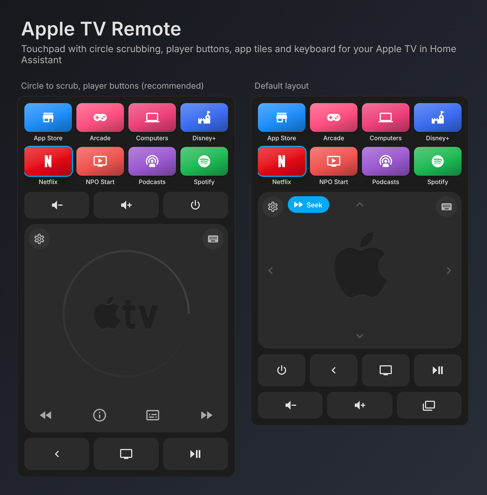
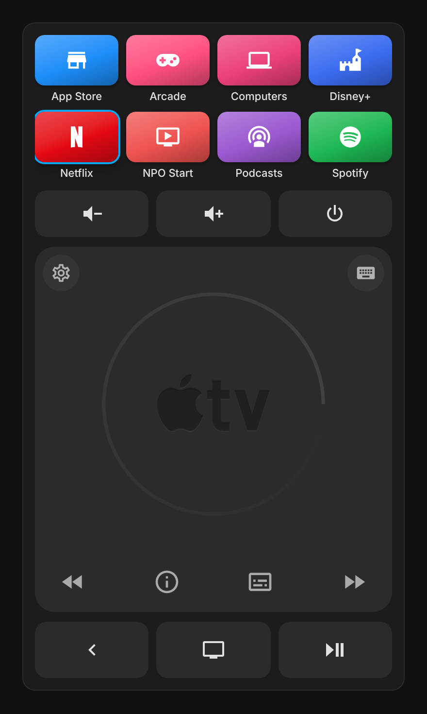
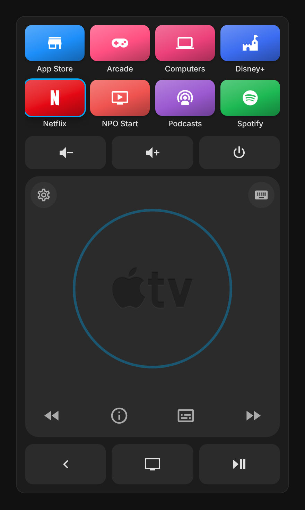
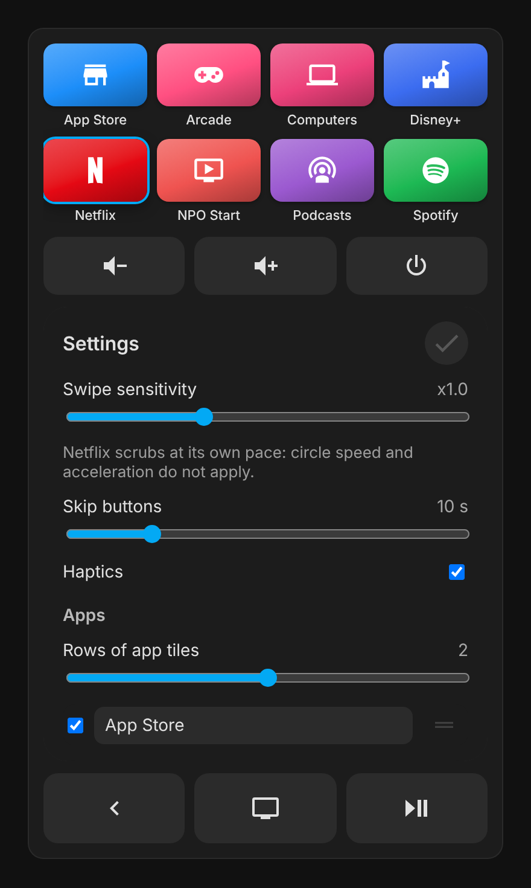
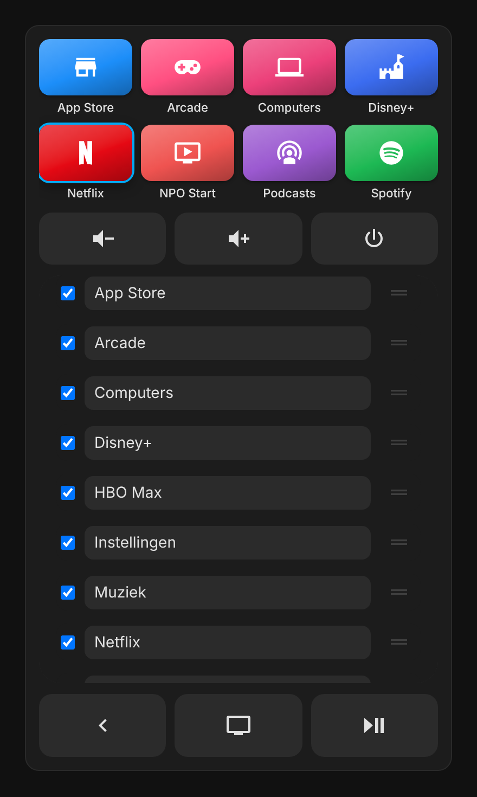
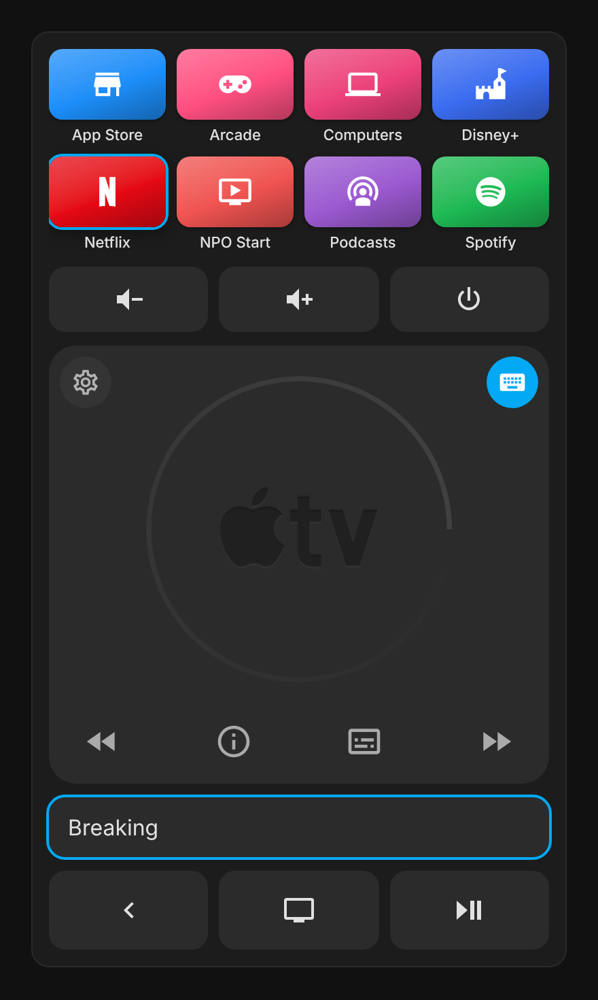
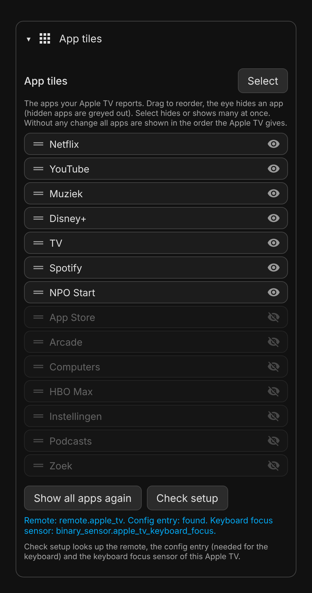

# Apple TV Remote for Home Assistant

[](https://hacs.xyz)
[](https://www.home-assistant.io)
[](LICENSE)

A phone remote for your **Apple TV**, as a Home Assistant dashboard card: a **touchpad** you can **circle to scrub** through a
video (with the **jog ring** of Apple's own player), the **player buttons** of Apple's Remote app, **tiles for your apps**, a
**keyboard**, **mute**, **control centre** and quick **settings** on the pad. Everything is set up in the card's visual editor, no
YAML needed.



<sub>The pictures in this README are rendered images made with the card's own code and sample data, not screenshots from a phone. They use a dark theme; the card in your dashboard follows your own theme.</sub>

## Features

- **Touchpad**: swipe = arrow keys, tap = select. Slow swipes move one item at a time, fast swipes move quickly.
- **Circle to scrub**: go round on the pad and the video scrubs, clockwise forward, anticlockwise back, for as long as you keep
  turning. Works in YouTube, Netflix and every other app; the faster you turn, the further it goes. A light tick every twelfth of a
  turn, like a dial.
- **Jog ring**: rest your finger a moment before circling and you get the jog ring of Apple's own player (Apple TV app), exactly
  like the ring of the Siri Remote. A playing video pauses for it.
- **Player buttons** like Apple's Remote app: 10 seconds back, info, 10 seconds forward.
- **App tiles** for every app your Apple TV reports: App Store apps with their **real icon**, Apple's own apps with a colour plate, the rest with a symbol and brand colour. A tile wakes a sleeping Apple TV first.
- **Buttons**: power, back, TV / Home, play / pause, volume and an app switcher. **Hold volume down to mute** (the Apple TV has no
  mute key; the card sets the volume to 0 and back).
- **Power**: tap = control centre, hold = sleep, and it wakes the Apple TV when it is asleep.
- **Keyboard**: the text box opens by itself when a text field on the Apple TV has focus; what you type goes straight into it.
- **Quick settings** behind a cogwheel on the pad: swipe sensitivity, circle speed, skip seconds, haptics. Kept per phone.
- **Layout to taste**: Apple TV logo (or logo + "tv") on the pad, arrows on or off, the volume row above or below, power where you
  want it, pad height.
- One card per Apple TV for several Apple TVs, nothing to install on the Apple TV, no dashboard resource to add: the card loads itself.

## Requirements

- Home Assistant **2024.8** or newer.
- The core **Apple TV** integration, set up for your Apple TV (this integration builds on it and uses its remote, media player and
  keyboard services).
- The **volume** buttons only work when the Apple TV is set up to control your TV or soundbar volume (HDMI-CEC or IR).
- **Circle scrubbing, the jog ring, player buttons and mute** use the Apple TV's Companion link, which the core integration sets up when you pair the Apple TV.

## Installation

### HACS (custom repository)

[](https://my.home-assistant.io/redirect/hacs_repository/?owner=vandalon&repository=ha-apple-tv-remote&category=integration)

The button above opens HACS in your Home Assistant and offers to add this repository. Or add it by hand:

1. Open **HACS** in the sidebar, then the menu (three dots, top right) **> Custom repositories**.
2. Paste `https://github.com/vandalon/ha-apple-tv-remote`, choose the type **Integration** and press **Add**.
3. Close the dialog and open the **Marketplace** in HACS (older HACS versions call it *Explore & download repositories*).
   Search for **Apple TV Remote** and press **Download**.
4. **Restart Home Assistant** (Settings > System > Restart). HACS asks for this after the download as well.

Updates then show up in HACS like any other integration; restart Home Assistant after each update, the Python part is only loaded at
startup. HACS can only reach a repository that is public (or that you gave HACS access to).

### Manual (without HACS)

1. **Download** the package: on the repository page press **Code > Download ZIP** (or download the source of the latest release),
   and unzip it. You only need the folder `custom_components/apple_tv_remote`.
2. **Copy that folder** into the `custom_components` folder of your Home Assistant configuration, so that you end up with
   `config/custom_components/apple_tv_remote/manifest.json` (create `custom_components` if it does not exist). Ways to get there:
   - the **Samba share** add-on (the `config` share), the **File editor** or **Studio Code Server** add-on, or the **Advanced SSH** add-on;
   - on Home Assistant Container/Core simply copy it to your configuration directory, for example
     `cp -r custom_components/apple_tv_remote /path/to/config/custom_components/` on Linux or macOS.
3. **Restart Home Assistant** (Settings > System > Restart).
4. Continue with [Setup](#setup).

To update, replace the `apple_tv_remote` folder with the new version and restart Home Assistant again.

## Setup

1. **Settings > Devices & services > Add integration > Apple TV Remote** (one click, nothing to configure).
2. Open a dashboard, **Edit dashboard > Add card**, search for **Apple TV remote** and pick your Apple TV.

```yaml
type: custom:atv-touchpad
entity: media_player.living_room_apple_tv
```

The layout in the picture above (left), recommended for a phone:

```yaml
type: custom:atv-touchpad
entity: media_player.living_room_apple_tv
source_rows: 2
circle_scrub: true      # circle on the pad to scrub
player_buttons: true    # 10 s back, info, 10 s forward
edge_arrows: false      # no arrows on the pad, every tap is select
swipe_hold: false
logo_text: tv
volume_row: top         # volume and power above the pad
power_position: bottom
pad_ratio: 1.15
```

Only the **entity** (the Apple TV media player) is needed. The card finds the remote entity, the config entry (for the keyboard) and
the keyboard focus sensor of the same device by itself. In the editor, **App tiles > Check setup** shows what it found.

## The card



- **Touchpad**: swipe for the arrow keys, tap to select. With `edge_arrows: true` (default) the pad shows arrows and a tap near an
  edge sends that arrow; `edge_arrows: false` hides them and every tap is select.
- **Logo**: the Apple logo on the pad looks engraved; `logo_text: tv` adds "tv" after it, drawn to match the Apple TV logo.
- **Rows**: back, TV / Home and play / pause below the pad; volume down, volume up and the app switcher (or power with
  `power_position: bottom`) in a second row, below or (`volume_row: top`) above the pad.
- **Size**: with `height: auto` the pad keeps the shape `pad_ratio` (width / height, default 1.3; lower = taller). Set a CSS height
  such as `70vh` or `100%` and the pad fills the spare space instead, for example in a pop-up. The card keeps its height whether the
  text box is shown or not.
- **Pop-ups**: swipes on the touchpad never reach the pop-up around it (no swipe-to-close while you steer), and `show_border: false`
  removes the card frame.

### Circle to scrub

With `circle_scrub` on (the default) a faint ring shows round the logo. Draw circles on the pad to scrub through a video:

- **Start on the ring** drawn round the logo and going round scrubs at once, with no arrow keys (the ring turns green). Start anywhere else and a swipe is an arrow key as usual; a circle there is recognised after about a quarter turn.
- **Clockwise = forward, anticlockwise = back**, for as long as you keep turning. The card starts after about a quarter turn, so a
  straight swipe stays an arrow key.
- **Any app**: the turning becomes one long sideways touch on the Apple TV, the way you scrub with the Siri Remote. One turn at a
  normal pace (about 1.3 s) is a swipe across the whole touch surface (`circle_turn`, Netflix 2.7x because it scrubs less per swipe).
- **Speed**: the faster you turn, the further each turn goes, gradually from 0.1x (very slow) to 3x (fast) (`circle_accel`; 0 = always
  the same).
- **Feel**: a light tick every twelfth of a turn (where the phone allows vibration).
- Scrubbing by touch works on a **paused** video in most apps; in YouTube the focus must be on the progress bar.



**The jog ring.** Apple's own video player (the Apple TV app and apps that use Apple's player) has a *jog ring*: on the Siri Remote you
rest your thumb on the edge of the clickpad, a small ring appears on the progress bar, and going round scrubs precisely. The card does the
same:

1. Put your finger on the pad and **hold it still** for a moment (`ring_hold`, 350 ms). The ring on the pad lights up and a playing
   video pauses (`ring_pause`).
2. **Go round the ring.** Your finger's place round the ring is the place on the Apple TV's ring, so it follows your finger exactly.
3. **Let go** and the video plays on (`ring_resume`).

Apps with their own player (YouTube, Netflix, Disney+ ...) have no jog ring; Apple offers it only with its own player. There a plain
circle is the way to scrub. Resting first is also a quick test: if the ring appears on the TV, that app uses Apple's player. Apps in
`circle_native_apps` use the ring even for a plain circle.

### Progress bar

While the app on screen reports a real position and length (the Apple TV app does; YouTube and Netflix do not), a progress bar
sits between the touchpad and the buttons below it: a slim line you drag, and the TV follows live while you drag (a jump
about every 0.3 s, the last one where you let go). Dragging it never swipes the pop-up, the view or the pad. An app that
ignores the jump loses the bar on that device. Turn it off with `progress_bar: false`.

### Player buttons

`player_buttons: true` adds a row like the bottom of Apple's Remote app to the pad (which gets taller to make room):

- **Rewind / fast forward** (double arrows): tap = the Apple TV's own skip of `skip_seconds` (10, also under the cogwheel); hold = rewind / fast forward until you let go, like holding the Siri Remote.
- **Info**: a Down press, which opens the info panel of Apple's player.

### Quick settings



The cogwheel on the pad (`settings_button`) opens settings you may want to change on the spot. They change the card's own options on the
dashboard (saved a moment after the last change, for everyone who uses the dashboard; only an administrator can change them):

- **Swipe sensitivity**: half to double (higher = a shorter swipe per step).
- **Circle scrub speed** and **Circle acceleration** (0 = off): per app. They change the app on screen ("for Netflix"); with no app open they set the value for all apps without their own. *Same as the other apps* drops an app's own value.
  Netflix has no speed setting: it only follows calm swipes at its own pace (about 3 to 5 minutes of video per second of circling), so the sliders are left out there.
- **Skip buttons**: seconds per skip.
- **Haptics**: on or off.
- **Rows of app tiles**: 1 to 4, or all; and whether the **app names** show under the tiles.
- **Apps**: every app the Apple TV lists: tick to show or hide its tile (also apps the card's options hide), hold the handle and drag to change the order, and type a name of your own. Handy on one phone without editing the dashboard.



### Mute

The Apple TV has no mute key. **Hold volume down** (0.6 s) and the card sets the volume to 0 and remembers the level; hold it again
for the sound back (`mute_hold`). This needs an Apple TV that controls the volume (HDMI-CEC or IR).

### Keyboard

The core Apple TV integration provides a *Keyboard focus* sensor (it may be hidden in the entity list). When it is on, the text box
opens by itself. The keyboard button on the pad shows or hides it by hand, for example when the Apple TV does not report the focus.



### Other ways to scrub

Besides circling: the **progress bar** under the touchpad (drag it, the TV follows; only in apps that report a position, such as
the Apple TV app) and the **skip buttons** of the player row (tap = skip, hold = fast forward / rewind).

### Apps


- **Tiles**: `source_rows` sets the number of lines. When there are more tiles than fit (`tiles_across` x lines), they go on
  pages: the first tiles in your order are in view (3 lines of 4: tiles 1-12), the rest on the next pages, each filled left to
  right and top to bottom; a swipe moves one whole page. A few tiles are centred.
- **`source_order`** is both the filter and the order: only the listed tiles are shown, in that order. Empty shows every app.
- **Colours and icons**: known apps (Netflix, YouTube, Spotify, Prime Video, Disney+, HBO Max, Apple TV, AirPlay, Twitch, Plex,
  Kodi, Steam, Music, Podcasts, Photos, App Store, Arcade, Settings, Fitness, broadcaster apps, English and Dutch names) are
  recognised by name. Anything else gets a neutral icon and its own colour (the same app always gets the same one). Override
  with `source_icons`:

```yaml
source_icons:
  Plex: mdi:plex
  My app: { icon: mdi:rocket, color: "#107c10" }
```

Icons come from Home Assistant's built-in Material Design Icons, no image files are needed. App names that contain
non-breaking spaces (the Apple TV does that) are shown with normal spaces.

### Your own logos

The card ships no logos of its own. To give an app a logo of your choice, put the image in your configuration's `www` folder (for
example `config/www/app-logos/photos.svg`, served as `/local/app-logos/photos.svg`) and point the app to it, with the plate colour behind it:

```yaml
source_icons:
  "Foto's": { image: /local/app-logos/photos.svg, color: "#ffffff" }
  TV: { image: /local/app-logos/appletv.svg, color: "#000000" }
```

The image is shown on a plate in the tile's shape. For an image that is a whole tile itself (5:3, its own background) add `fill: true`: it then covers the tile. App names match with either apostrophe (Foto's / Foto’s). Make sure you may use the logo you add.

To build your logos into the card itself instead (for every card, without `source_icons`), the repository has a small script that writes
the paths into the card's `OWN_LOGOS` list (the images stay in your `www` folder):

```bash
python3 scripts/atv_logos.py "Foto's=photos.svg@linear-gradient(135deg,#2c2c30,#000 70%)" "TV=appletv.svg@#000"
python3 scripts/atv_logos.py --list          # show them; --remove TV drops one, --clear drops all
```

`source_icons` in a card still wins over these.

**Tiles for Apple's own apps.** The card looks for whole-tile images (5:3, own background) for Apple's apps in `config/www/app-logos/tvos`
(option `stock_tiles` for another folder), with these file names: `Apple-TV.svg`, `Music.svg`, `Photos.svg`, `Apple-Arcade.svg`,
`Fitness.svg`, `App-Store.svg`, `Podcasts.svg`, `FaceTime.svg`, `Settings.svg`, `Search.svg`, `Apple-Music-Sing.svg`, `Home-Sharing.svg`.
Apps are recognised by their app ID, so this works whatever language your Apple TV is set to. Where a file is there it covers the tile; where not, the app keeps the card's own tile. The card ships no images.

To build such tiles into your own copy of the card, so it shows them without files in `www`, run
`python3 scripts/atv_logos.py --embed-stock path/to/folder` (and `--clear-stock` to remove them). The images then ship inside that build
of the card; only do that with images you may distribute.

### The visual editor



Open the card editor and expand **App tiles**. Drag a row by its handle to reorder, the **eye hides** an app (it stays in the
list, greyed out). **Select** hides or shows many apps at once, with a filter. **Show all apps again** clears the order and
shows every app, **Check setup** reports the remote, config entry and keyboard sensor it found.


Only options you change are saved in the YAML.

## Card options

All options are in the visual editor except the per-app lists (`source_icons` has its own editor; `circle_turn_apps`,
`hold_profiles` are YAML only).

**General**

| Option | Default | What it does |
|---|---|---|
| `entity` | required | The Apple TV media player |
| `remote` | found automatically | The remote entity |
| `keyboard_sensor` | found automatically | The Keyboard focus binary sensor |
| `haptics` | `true` | Vibrate on taps |
| `show_border` | `true` | `false` = no border and shadow (for pop-ups that bring their own frame) |
| `side_padding` | `12` | Pixels of space at the card's left and right edge; `0` = edge to edge |
| `height` | `auto` | `auto` or any CSS height |
| `pad_ratio` | `1.3` | Touchpad width / height with `height: auto` (lower = taller) |
| `settings_button` | `true` | The cogwheel with quick settings; they change and save this card's options (administrators) |
| `swipe_sensitivity` | `1` | Swipe sensitivity (divides `swipe_slow` / `swipe_fast`) |
| `circle_speed` / `circle_speed_apps` | `1` | Circle scrub speed, in general and per app (app name -> factor) |
| `circle_accel_apps` | none | Circle acceleration per app (app name -> value) |

**App tiles**

| Option | Default | What it does |
|---|---|---|
| `sources` | `true` | Show a tile per app |
| `source_order` | all apps | Show only these apps, in this order |
| `hide_sources` | none | App names to leave out |
| `source_style` | `tiles` | `tiles` (icon + name) or `chips` (name only) |
| `source_colors` | `true` | Colour the tiles |
| `source_rows` | `1` | Lines of tiles, 0 = as many as needed |
| `stock_tiles` | `/local/app-logos/tvos` | Folder in your config's `www` with whole-tile images for Apple's own apps (see *Your own logos*); `false` = off |
| `apple_app_icons` | `false` | TV, Music, Podcasts, Fitness and Photos show the square icon of their iPhone version (App Store) instead of a colour plate |
| `app_names` | `true` | Show the name under each app tile; `false` = icons only |
| `tiles_across` | `4` | tvOS-shaped app tiles: this many fill the card's width, more scroll sideways |
| `app_icons` | `true` | Tiles in the tvOS shape (5:3 icon, name under it): App Store apps with their real icon, the others a colour plate with a symbol; `false` = the plain tiles |
| `source_icons` | none | Icon and colour per app name; the icon can also be an image of your own (`/local/...` or a URL), shown on a plate in the tile's shape |
| `source_names` | none | Your own name per app tile (app name -> name) |

**Buttons and layout**

| Option | Default | What it does |
|---|---|---|
| `app_switcher` | `true` | App switcher button (double-press of TV / Home) |
| `volume` | `true` | Volume down / up buttons |
| `mute_hold` | `true` | Hold volume down = mute, hold again = sound back |
| `nav_order` | `back,home,play` | Order of the back, TV / Home and play / pause buttons |
| `power_position` | `top` | `bottom` = power is the last button of the volume row, in place of the app switcher |
| `volume_row` | `bottom` | `top` = the volume row sits just above the touchpad |
| `keyboard` | `true` | Keyboard button on the pad |
| `player_buttons` | `false` | 10 s back, info, 10 s forward at the bottom of the pad |
| `skip_seconds` | `10` | Seconds per skip |
| `edge_arrows` | `true` | Arrows on the pad; a tap near an edge sends that arrow. `false` = every tap is select |
| `logo_text` | none | A word after the Apple logo, for example `tv` |

**Touchpad**

| Option | Default | What it does |
|---|---|---|
| `swipe_slow` | `96` | Pixels per step for a slow swipe |
| `swipe_fast` | `22` | Pixels per step for a fast swipe |
| `command_gap` | `140` | Milliseconds between two pad commands (the Apple TV drops faster ones) |
| `swipe_hold` | `true` | Swipe sideways and keep the finger down: the arrow key is held until you lift (fast forward / rewind) |
| `hold_swipe` | `30` | Swipe and hold: px of sideways movement before resting starts the hold |
| `swipe_hold_ms` | `500` | Swipe and hold: ms the finger rests before the hold starts |
| `hold_notch` | `40` | Swipe and hold: px outward / inward for one step faster / slower |
| `hold_profiles` | TV: cycle, YouTube: smooth, Netflix: step | Swipe and hold: what a step means per app (`cycle`, `smooth`, `step`, `hold`) |

**Circle to scrub**

| Option | Default | What it does |
|---|---|---|
| `circle_scrub` | `true` | Circle on the pad to scrub; a ring round the logo shows it is on |
| `circle_turn` | `1000` | Distance of one turn (1000 = a swipe across the whole touch surface) |
| `circle_sweep_apps` | Netflix | Apps that ignore short quick swipes: there a circle becomes calm swipes from edge to edge with a short pause between (`*` = every app) |
| `circle_turn_apps` | Netflix: `2700` | `circle_turn` per app (app name -> units per turn) |
| `circle_accel` | `1` | A fast turn scrubs further than a slow one (0.1x to 3x; 0 = off, higher = stronger) |
| `ring_hold` | `350` | Milliseconds the finger rests before circling to get the jog ring |
| `ring_pause` | `true` | Resting for the jog ring pauses a playing video |
| `ring_resume` | `true` | Letting go after the jog ring plays the video again |
| `circle_native_apps` | none | Apps where even a plain circle uses the jog ring (`*` = every app) |


## How it works

The card talks to the Apple TV through the **core Apple TV integration**: keys, apps and the keyboard through its remote and media
player entities. What the core integration does not offer (touch events for scrubbing and the jog ring, held keys, skip,
volume for mute) goes through this integration's websocket commands, which use the Companion connection the core integration already
holds (pyatv). Because this reaches into the core integration, a core update can break those parts; the rest of the card keeps working,
and the card says so when touch is not available.

## Where things are stored

- **Card options and icons**: the card's YAML in your dashboard.
- **Quick settings**: the browser's local storage, per phone or browser.
- The integration stores nothing; it serves the card script and answers the card's websocket commands.
- **App icons**: the integration asks the Apple TV for its app list (bundle IDs) and looks each App Store app up once per Home Assistant run on Apple's public App Store lookup (`itunes.apple.com`, with your Home Assistant country). Each icon is downloaded once to `config/apple_tv_remote_icons` on the Home Assistant server (with `index.json`) and Home Assistant serves it to every device at `/apple_tv_remote/icons/...`, so phones and tablets never contact Apple. Once a week, in the background, the integration checks Apple again and only downloads an icon that changed. Delete the folder to start over. Apple's own apps are not in the App Store under their Apple TV IDs, so they get the card's own colour plate (with `apple_app_icons: true`, TV, Music, Podcasts, Fitness and Photos show the square icon of their iPhone version instead). Turn it off with `app_icons: false`.

## Troubleshooting

- **The card is not in the picker**: restart Home Assistant after installing, make sure the integration is added, then fully
  reload the page or the app (Companion app: Settings > Debugging > Reset frontend cache).
- **Nothing happens when you press a button**: open the editor and press **Check setup**. If the remote is not found, set `remote`.
- **Check setup says the integration is not updated**: restart Home Assistant after an update.
- **No keyboard button**: it needs the config entry, so the integration must be set up and Home Assistant restarted once.
- **The text box does not open by itself**: the Apple TV integration's *Keyboard focus* sensor may be disabled; enable it, or set
  `keyboard_sensor`. The keyboard button always works.
- **The app switcher does nothing**: it sends two TV / Home presses 0.2 s apart. If your Apple TV does not react, hide it with
  `app_switcher: false`.
- **The Apple TV skips swipes**: raise `command_gap` or `swipe_slow`.
- **Circles do nothing**: `circle_scrub` must be on. Restart Home Assistant after installing or updating; the card says *Touch scrubbing is not available* when the Companion link does not answer.
- **No jog ring on the TV**: only apps with Apple's own player have one (the Apple TV app); the video should be paused with the progress bar on screen. Elsewhere use a plain circle.
- **Circling scrubs too much or too little**: change *Circle scrub speed* and *Circle acceleration* under the cogwheel.
- **An app tile is missing**: the Apple TV only lists apps it can launch. Hidden by `source_order` or `hide_sources`?
- **The app tiles stay while the Apple TV is off**: on purpose. An Apple TV that is off reports no apps, so the card keeps the last list it saw (per browser); a tile wakes the Apple TV first.
- **"Not connected" / the remote cannot turn the Apple TV on**: Home Assistant's Apple TV integration sometimes stays disconnected (for example when the Apple TV slept through a restart). The card then asks this integration to reconnect it: it reloads that Apple TV's entry, only when it really is not connected and at most every 30 s. Needs a Home Assistant restart after updating.

## Support

Questions and bugs: [GitHub issues](https://github.com/vandalon/ha-apple-tv-remote/issues).

## License

MIT, see [LICENSE](LICENSE).
